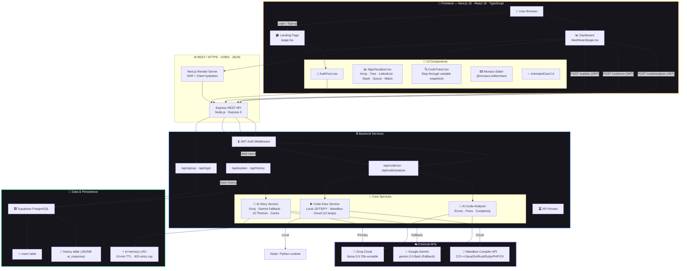
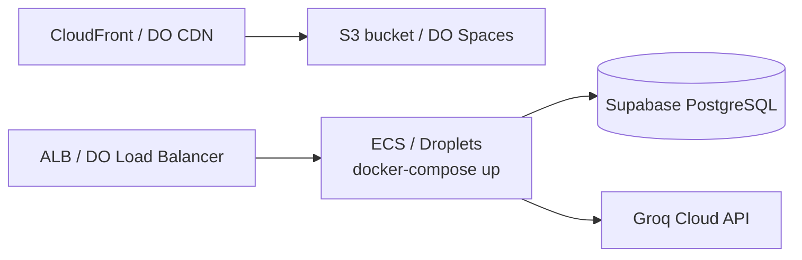

<!-- ═══════════════════════════════════════════════════════════════════════════════ -->
<!--                               CODEFABLE README                               -->
<!-- ═══════════════════════════════════════════════════════════════════════════════ -->

<!-- ─────────────────────────────── Hero Banner ─────────────────────────────── -->

<p align="center">
  <a href="https://github.com/">
    
  </a>
</p>

<p align="center">
  
</p>

<!-- ───────────────────────────── Quick Info Bar ────────────────────────────── -->

<p align="center">
  <kbd>
    
  </kbd>
  <kbd>
    
  </kbd>
  <kbd>
    
  </kbd>
  <kbd>
    
  </kbd>
  <kbd>
    
  </kbd>
  <kbd>
    
  </kbd>
  <kbd>
    
  </kbd>
</p>

<!-- ───────────────────────────── Shields.io Badges ─────────────────────────── -->

<p align="center">
  
  
  
  
  
  
  
  
  
  
  
  
</p>

<!-- ───────────────────────────── CTA Buttons ───────────────────────────────── -->

<p align="center">
  <a href="#-quick-start">
    
  </a>
  <a href="#-live-demo">
    
  </a>
  <a href="#-architecture">
    
  </a>
  <a href="https://github.com/">
    
  </a>
</p>

<br>

---

<!-- ══════════════════════════════════════════════════════════════════════════════ -->
<!--                                 INTRODUCTION                                 -->
<!-- ══════════════════════════════════════════════════════════════════════════════ -->

<p align="center">
  
</p>

> **CodeFable** transforms how people learn programming. Instead of dry tutorials and abstract pseudocode, we wrap every Data Structure, every Algorithm, and every line of Code into immersive, memorable **stories** — from detective mysteries to royal kingdoms, cricket matches to space missions.
>
> Combined with **interactive visualizations** (trees drawn as trees, arrays as bars, linked lists with arrows), a **full Monaco Code Editor**, **12-language execution support**, and **AI-powered code analysis**, CodeFable is the flagship platform that makes DSA actually **stick**.

<br>

<!-- ══════════════════════════════════════════════════════════════════════════════ -->
<!--                                    FEATURES                                  -->
<!-- ══════════════════════════════════════════════════════════════════════════════ -->

<p align="left"><a name="-features"></a></p>

##  &nbsp; Features

<p align="center">
  
</p>

<div align="center">
<table>
<tr>
<td width="50%">

###  &nbsp; Immersive Story Engine
> Every DSA problem becomes a **mini-movie** with named characters, tension, and resolution. Choose from 10+ rotating themes:
> <br>🔍 Detective Mystery &nbsp; · &nbsp; 👑 Raja-Rani Kingdom &nbsp; · &nbsp; 🏏 Cricket Match
> <br>🚀 Space Mission &nbsp; · &nbsp; 🏫 School Classroom &nbsp; · &nbsp; 🍽️ Restaurant & Food
> <br>🎬 Bollywood Film &nbsp; · &nbsp; 💼 Startup & Business &nbsp; · &nbsp; 🗺️ Treasure Hunt
> <br>🏥 Hospital & Doctor

</td>
<td width="50%">

###  &nbsp; Smart Data-Structure Visualization
> AI **auto-detects** the data structure from your problem and renders it perfectly:
> <br>📊 **Arrays / Sorting / Two Pointers** — animated bar chart with highlight effects
> <br>🌳 **Binary Trees / BST** — hierarchical level-order tree visualization
> <br>🔗 **Linked Lists / Queues** — nodes connected with directional arrows
> <br>📚 **Stacks** — true stack view with "Top" label
> <br>⊞ **Matrices / 2D Grids** — color-coded grid rendering
> <br>🕸️ **Graphs** — adjacency rendering

</td>
</tr>
<tr>
<td width="50%">

###  &nbsp; Full Monaco Code Editor
> **Write, edit, and run** code in 12+ languages directly inside the dashboard, powered by the same editor that drives VS Code:
> <br>✅ JavaScript, Python, TypeScript *(local execution)*
> <br>✅ Java, C++, C, Go, Rust, Ruby, PHP, C#, Kotlin *(Wandbox Cloud)*
> <br>✅ Syntax highlighting, autocomplete, minimap, themes
> <br>✅ Custom stdin input support
> <br>✅ Stdout / Stderr console with timestamps

</td>
<td width="50%">

###  &nbsp; Multilingual AI Tutor
> Get explanations in **4 languages** — pick whatever feels most natural:
> <br>🇬🇧 **English** — crisp, engaging, professional
> <br>🇮🇳 **Hindi** — pure Devanagari (हिंदी)
> <br>🇮🇳 **Hinglish** — the casual roman-script mix that India actually speaks
> <br>🇮🇳 **Marathi** — pure Devanagari (मराठी)
> <br>
> Technical terms always stay in English, so you never miss a keyword.

</td>
</tr>
<tr>
<td width="50%">

###  &nbsp; AI Code Analysis
> Run your code and instantly get:
> <br>❌ Error explanations in plain language
> <br>🔧 Step-by-step fixes with context
> <br>✨ Code quality and readability tips
> <br>💡 3+ concrete improvement suggestions
> <br>⏱️ Time & Space complexity analysis

</td>
<td width="50%">

###  &nbsp; Playback Controls & Tracing
> Watch algorithms **unfold step by step**:
> <br>▶️ Play / Pause animation
> <br>⏮️ ⏭️ Step forward & backward
> <br>⚡ 0.5x · 1x · 2x · 4x speed control
> <br>🔁 Reset to initial state
> <br>👀 Toggle input data preview
> <br>📍 Named pointer overlays (i, j, left, right, slow, fast…)
> <br>🔍 **CodeTracer** — snapshot-by-snapshot variable inspector

</td>
</tr>
<tr>
<td width="50%">

###  &nbsp; Secure Authentication
> Production-grade auth, out of the box:
> <br>✅ JWT-based sessions (7-day expiry)
> <br>🔐 bcrypt password hashing with salt rounds
> <br>🛡️ Protected API routes via auth middleware
> <br>🗄️ Supabase PostgreSQL as the user & session store

</td>
<td width="50%">

###  &nbsp; History & Progress
> Never lose a learning moment:
> <br>📜 Full 50-entry history of every explanation
> <br>🔍 Per-user scoped queries
> <br>⚡ 10-minute in-memory response cache for duplicate questions
> <br>📅 Most recent first, chronologically ordered

</td>
</tr>
</table>
</div>

<br>

<!-- ══════════════════════════════════════════════════════════════════════════════ -->
<!--                                   SCREENSHOTS                                -->
<!-- ══════════════════════════════════════════════════════════════════════════════ -->

##  &nbsp; Screenshots

<p align="center">
  
</p>

<p align="center">
  <table>
    <tr>
      <td align="center" width="50%">
        <b>🖥️ Dashboard — Main View</b><br><br>
        <a href="#">
          
        </a>
      </td>
      <td align="center" width="50%">
        <b>🌳 Algorithm Visualizer — Tree Mode</b><br><br>
        <a href="#">
          
        </a>
      </td>
    </tr>
    <tr>
      <td align="center" width="50%">
        <b>🔐 Authentication Screen</b><br><br>
        <a href="#">
          
        </a>
      </td>
      <td align="center" width="50%">
        <b>⌨️ Monaco Code Editor + Execution</b><br><br>
        <a href="#">
          
        </a>
      </td>
    </tr>
    <tr>
      <td align="center" width="50%">
        <b>📱 Mobile — Responsive Dashboard</b><br><br>
        <a href="#">
          
        </a>
      </td>
      <td align="center" width="50%">
        <b>📊 Analytics & History Panel</b><br><br>
        <a href="#">
          
        </a>
      </td>
    </tr>
  </table>
</p>

<details><summary><b>📁 View Thumbnail Gallery Grid</b></summary>
<br>
<p align="center">
  
  
  
  
</p>
</details>

<br>

<!-- ══════════════════════════════════════════════════════════════════════════════ -->
<!--                                     DEMO                                     -->
<!-- ══════════════════════════════════════════════════════════════════════════════ -->

##  &nbsp; <a name="-live-demo"></a>Live Demo

<p align="center">
  
</p>

<p align="center">
  <table>
    <tr>
      <td align="center" width="33%">
        <a href="#">
          
        </a>
        <p>Watch a 60-second product walkthrough</p>
      </td>
      <td align="center" width="33%">
        <a href="#">
          
        </a>
        <p>Full feature showcase & tutorial</p>
      </td>
      <td align="center" width="33%">
        <a href="#">
          
        </a>
        <p>Launch the fully-hosted app</p>
      </td>
    </tr>
  </table>
</p>

<details>
<summary><b>▶️ Click to view embedded demo preview</b></summary>
<br>

> 🎥 *Note: The embedded preview below is a placeholder — replace with your real GIF or MP4 URL when ready.*

<p align="center">
  
</p>
</details>

<br>

<!-- ══════════════════════════════════════════════════════════════════════════════ -->
<!--                                  ARCHITECTURE                                -->
<!-- ══════════════════════════════════════════════════════════════════════════════ -->

##  &nbsp; <a name="-architecture"></a>Architecture

<p align="center">
  
</p>



<details>
<summary><b>🔍 Layer breakdown — what talks to what</b></summary>
<br>

| Layer | Responsibility | Tech |
|-------|---------------|------|
| **Presentation** | SSR + SPA, story UI, visualizer, editor | Next.js 15 · React 19 · Tailwind v4 · Monaco · Lucide |
| **API Gateway** | Auth validation, rate-limits, routing, CORS | Express 5 · JWT · Cors middleware |
| **Business** | Story generation, code execution, analysis, caching | Groq SDK · @google/genai · child_process · In-memory Map |
| **Persistence** | Users, sessions, history, JSONB responses | Supabase (PostgreSQL + Auth) |
| **External** | LLM inference, multi-language compilers | Groq Cloud · Google GenAI · Wandbox API |

</details>

<br>

<!-- ══════════════════════════════════════════════════════════════════════════════ -->
<!--                                   TECH STACK                                 -->
<!-- ══════════════════════════════════════════════════════════════════════════════ -->

##  &nbsp; Tech Stack

<p align="center">
  
</p>

### 🎨 Frontend

<p align="left">
  
  
  
  
  
  
  
  
</p>

### ⚙️ Backend

<p align="left">
  
  
  
  
  
  
  
</p>

### 💾 Database

<p align="left">
  
  
  
  
</p>

### 🤖 AI / ML

<p align="left">
  
  
  
  
  
</p>

### 🔧 DevOps / Tools

<p align="left">
  
  
  
  
  
  
</p>

### ✅ Testing & Quality

<p align="left">
  
  
  
</p>

<br>

<!-- ══════════════════════════════════════════════════════════════════════════════ -->
<!--                                  QUICK START                                 -->
<!-- ══════════════════════════════════════════════════════════════════════════════ -->

##  &nbsp; <a name="-quick-start"></a>Quick Start

<p align="center">
  
</p>

### ⚡ One-liner (Clone + Install everything)

```bash
git clone https://github.com/your-org/CodeFable.git && cd CodeFable \
  && npm --prefix backend install && npm --prefix frontend install
```

### 📋 Prerequisites

| Requirement | Minimum | Recommended | Get it |
|---|---|---|---|
| **Node.js** | v18.17 LTS | v20.11 LTS | [nodejs.org](https://nodejs.org) |
| **npm** | v9 | v10+ | Shipped with Node |
| **Supabase Account** | — | Free Tier | [supabase.com](https://supabase.com) |
| **Groq API Key** | — | Free Tier | [console.groq.com](https://console.groq.com) |
| **Gemini API Key** *(optional)* | — | Free Tier | [aistudio.google.com](https://aistudio.google.com) |

---

### 🛠️ 1. Backend Setup

```bash
# Step A — Navigate & install
cd backend
npm install
```

```bash
# Step B — Configure environment
cp .env .env.local 2>/dev/null; code .env
```

Paste in your real credentials (see [Environment Variables](#-environment-variables)):

```env
PORT=5000
SUPABASE_URL=https://xxxxxx.supabase.co
SUPABASE_SERVICE_ROLE_KEY=eyJhbGciOiJIUzI1NiI...
JWT_SECRET=your-256-bit-secret-here-change-me
GROQ_API_KEY=gsk_xxxxxxxxxxxxxxxxxxxxxxxx
GEMINI_API_KEY=AIzaSyxxxxxxxxxxxxxxxxxxxxxxxxx
```

```bash
# Step C — Run the dev server (Nodemon auto-reloads)
npm run dev
# ✅ Backend live on http://localhost:5000
```

> 💡 **Supabase Pro Tip:** Use the **Service Role Key** on the server to bypass Row-Level Security for the `users` and `history` tables. See the SQL setup in [Environment Variables](#-environment-variables).

---

### 🎨 2. Frontend Setup

```bash
# New terminal, from project root
cd frontend
npm install

# Optional: point to a custom backend (defaults to http://localhost:5000)
echo "NEXT_PUBLIC_API_URL=http://localhost:5000" > .env.local

npm run dev
# ✅ Frontend live on http://localhost:3000
```

Open **[http://localhost:3000](http://localhost:3000)** — that's it! 🎉

---

### 🐳 3. Docker Setup (Optional)

<details>
<summary><b>📦 Expand — Docker & docker-compose</b></summary>

Create `Dockerfile.backend`:

```dockerfile
FROM node:20-alpine AS backend
WORKDIR /app
COPY backend/package*.json ./
RUN npm ci --omit=dev
COPY backend/ .
EXPOSE 5000
CMD ["node", "index.js"]
```

Create `Dockerfile.frontend`:

```dockerfile
FROM node:20-alpine AS frontend-builder
WORKDIR /app
ENV NEXT_TELEMETRY_DISABLED=1
COPY frontend/package*.json ./
RUN npm ci
COPY frontend/ .
RUN npm run build
EXPOSE 3000
CMD ["npm", "start"]
```

Create `docker-compose.yml`:

```yaml
services:
  backend:
    build: { context: ., dockerfile: Dockerfile.backend }
    env_file: backend/.env
    ports: ["5000:5000"]
    restart: unless-stopped

  frontend:
    build: { context: ., dockerfile: Dockerfile.frontend }
    environment:
      NEXT_PUBLIC_API_URL: "http://backend:5000"
    ports: ["3000:3000"]
    depends_on: [backend]
    restart: unless-stopped
```

Run with:

```bash
docker compose up -d --build
```

</details>

---

### 🚀 4. Production Deployment

See **[📦 Deployment](#-deployment)** for full walkthroughs on **Vercel · Railway · AWS · DigitalOcean · Netlify**.

<br>

<!-- ══════════════════════════════════════════════════════════════════════════════ -->
<!--                                PROJECT STRUCTURE                             -->
<!-- ══════════════════════════════════════════════════════════════════════════════ -->

##  &nbsp; Project Structure

<p align="center">
  
</p>

```
CodeFable/
├── 📂 backend/                            # ─── Node.js + Express API ───
│   ├── 📂 lib/
│   │   └── supabase.js                    # Supabase client (auto service-role)
│   ├── 📂 middleware/
│   │   └── auth.js                        # JWT Bearer token verifier
│   ├── 📂 models/                         # (legacy Mongoose — kept for reference)
│   │   ├── History.js
│   │   └── User.js
│   ├── 📂 routes/
│   │   ├── auth.js                        # POST /signup  ·  POST /login
│   │   ├── ai.js                          # POST /explain  ·  GET /history
│   │   └── code.js                        # POST /code/run  ·  POST /code/analyze
│   ├── 📂 services/
│   │   └── ai.js                          # Story engine  ·  10 themes  ·  Groq+Gemini  ·  cache
│   ├── index.js                           # Express entry · CORS · error handler · logging
│   └── package.json                       # Deps: express, supabase-js, groq-sdk, @google/genai, bcrypt, jwt
│
├── 📂 frontend/                           # ─── Next.js 15 + React 19 ───
│   ├── 📂 public/                         # Static assets (globe, window SVGs)
│   ├── 📂 src/
│   │   ├── 📂 app/
│   │   │   ├── 📂 dashboard/
│   │   │   │   └── page.tsx               # MAIN dashboard — stories · editor · viz · console
│   │   │   ├── page.tsx                   # Landing page · hero · auth · 4-card grid
│   │   │   ├── layout.tsx                 # Inter + Playfair fonts · metadata
│   │   │   └── globals.css                # Tailwind v4 · theme tokens · fade-in keyframes
│   │   ├── 📂 components/
│   │   │   ├── ui/
│   │   │   │   └── animated-card.tsx      # Reusable glass card w/ hover gradient
│   │   │   ├── AlgoVisualizer.tsx         # 6-type viz: array · tree · ll · stack · queue · matrix
│   │   │   ├── CodeTracer.tsx             # Step-through snapshots · var inspector
│   │   │   └── AuthForm.tsx               # Login/Signup tab switcher · JWT store
│   │   └── 📂 lib/
│   │       └── utils.ts                   # cn() — clsx + tailwind-merge
│   ├── next.config.ts
│   ├── tsconfig.json
│   ├── eslint.config.mjs
│   ├── postcss.config.mjs
│   └── package.json                       # Deps: next, react, monaco-editor/react, lucide, tailwind-merge
│
├── .gitignore
└── README.md                               # ⭐ YOU ARE HERE
```

| File | Purpose |
|---|---|
| [`backend/index.js`](backend/index.js) | Express bootstrap · CORS whitelist · global error handler · request logger |
| [`backend/services/ai.js`](backend/services/ai.js) | **Core story engine** — 10 themes · prompt builder · Groq primary · Gemini fallback · 10-min cache · mock safety-net |
| [`backend/routes/ai.js`](backend/routes/ai.js) | POST `/explain` → story + save history · GET `/history` → last 50 |
| [`backend/routes/code.js`](backend/routes/code.js) | `/run` (local JS/TS/PY + Wandbox cloud) · `/analyze` (AI review of code+errors) |
| [`backend/lib/supabase.js`](backend/lib/supabase.js) | Single Supabase client init (auto Service Role for RLS bypass) |
| [`frontend/src/app/dashboard/page.tsx`](frontend/src/app/dashboard/page.tsx) | **Flagship page** — input · lang switch · explain btn · AI response · Monaco · viz · tracer |
| [`frontend/src/components/AlgoVisualizer.tsx`](frontend/src/components/AlgoVisualizer.tsx) | Render engine for bars, trees, linked lists, stacks, queues, matrices |
| [`frontend/src/components/CodeTracer.tsx`](frontend/src/components/CodeTracer.tsx) | Variable snapshot visualizer · output parser for arrays/objects per language |
| [`frontend/src/components/ui/animated-card.tsx`](frontend/src/components/ui/animated-card.tsx) | Glass-morphic UI building block |
| [`frontend/src/app/page.tsx`](frontend/src/app/page.tsx) | Marketing landing · animated hero · feature grid · auth |

<br>

<!-- ══════════════════════════════════════════════════════════════════════════════ -->
<!--                              ENVIRONMENT VARIABLES                           -->
<!-- ══════════════════════════════════════════════════════════════════════════════ -->

##  &nbsp; Environment Variables

<p align="center">
  
</p>

<div align="center">

### 📂 `backend/.env`

| Variable | Default | Required | Description |
|---|---|:---:|---|
| `PORT` | `5000` | ❌ | Port to expose the Express API on |
| `SUPABASE_URL` | — | ✅ | Supabase project URL<br>*(find in Supabase → Project Settings → API)* |
| `SUPABASE_ANON_KEY` | — | ⚠️ | Anon public key *(RLS-enabled path)* |
| **`SUPABASE_SERVICE_ROLE_KEY`** | — | ✅ | **Server-only service role key** — bypasses RLS for `users` + `history` inserts & queries |
| `JWT_SECRET` | `secret` (dev) | ✅ | 256-bit cryptographically-random secret for signing session tokens<br>⚠️ **CHANGE IN PRODUCTION** |
| `GROQ_API_KEY` | — | ✅ | Primary LLM provider — free tier available<br>👉 [console.groq.com](https://console.groq.com) |
| `GEMINI_API_KEY` | — | ❌ | Fallback LLM when Groq is rate-limited<br>👉 [aistudio.google.com](https://aistudio.google.com) |

<br>

### 📂 `frontend/.env.local`

| Variable | Default | Required | Description |
|---|---|:---:|---|
| `NEXT_PUBLIC_API_URL` | `http://localhost:5000` | ❌ | Absolute base URL of the running backend |

</div>

> 🗄️ **Run this SQL in your Supabase SQL Editor** to create the required tables:
>
> ```sql
> create table public.users (
>   id uuid primary key default gen_random_uuid(),
>   name text not null,
>   email text unique not null,
>   password text not null,
>   created_at timestamptz not null default now()
> );
>
> create table public.history (
>   id uuid primary key default gen_random_uuid(),
>   user_id uuid references public.users(id) on delete cascade not null,
>   input_text text not null,
>   language text not null,
>   ai_response jsonb not null,
>   created_at timestamptz not null default now()
> );
>
> create index idx_history_user_created on public.history(user_id, created_at desc);
>
> -- Recommended — keep RLS enabled + use SERVICE_ROLE_KEY on the backend:
> alter table public.users enable row level security;
> alter table public.history enable row level security;
> ```

<br>

<!-- ══════════════════════════════════════════════════════════════════════════════ -->
<!--                               API DOCUMENTATION                              -->
<!-- ══════════════════════════════════════════════════════════════════════════════ -->

##  &nbsp; API Documentation

<p align="center">
  
</p>

### 🌐 Base URL
```
http://localhost:5000   (dev)
https://your-domain.com (prod)
```

### 🔐 Authentication
All **protected** endpoints require the header:
```http
Authorization: Bearer <JWT_TOKEN_RETURNED_FROM_/SIGNUP_OR_LOGIN>
```

---

### 🛣️ Endpoint Index

| Method | Path | Auth | Purpose |
|---|---|:---:|---|
| `POST` | `/api/signup` | ❌ | Create a new user account |
| `POST` | `/api/login` | ❌ | Authenticate → retrieve JWT |
| `POST` | `/api/explain` | ✅ | Explain a DSA problem/code → story + visualization |
| `GET` | `/api/history` | ✅ | Fetch user's last 50 explanations |
| `POST` | `/api/code/run` | ✅ | Execute code in 12+ languages |
| `POST` | `/api/code/analyze` | ✅ | AI review of code, errors, output |

---

#### 1️⃣ `POST /api/signup`

```bash
curl -X POST http://localhost:5000/api/signup \
  -H "Content-Type: application/json" \
  -d '{"name":"Arya Khanna","email":"arya@codefable.dev","password":"SuperSecret123!"}'
```

✅ **201 Created**
```json
{
  "token": "eyJhbGciOiJIUzI1NiIsInR5cCI6IkpXVCJ9.eyJ1c2VySWQiOiI...",
  "user": { "id": "b8c8...", "name": "Arya Khanna", "email": "arya@codefable.dev" }
}
```

❌ **400 / 500**
```json
{ "error": "User already exists" }
```

---

#### 2️⃣ `POST /api/login`

```bash
curl -X POST http://localhost:5000/api/login \
  -H "Content-Type: application/json" \
  -d '{"email":"arya@codefable.dev","password":"SuperSecret123!"}'
```

✅ **200 OK**
```json
{
  "token": "eyJhbGciOiJIUzI1NiIsInR5cCI6IkpXVCJ9...",
  "user":  { "id": "b8c8...", "name": "Arya Khanna", "email": "arya@codefable.dev" }
}
```

---

#### 3️⃣ `POST /api/explain` *(protected)*

```bash
curl -X POST http://localhost:5000/api/explain \
  -H "Content-Type: application/json" \
  -H "Authorization: Bearer <JWT>" \
  -d '{
    "inputText": "Two Sum: nums = [2,7,11,15], target = 9",
    "language": "English"
  }'
```

✅ **200 OK** *(high-level shape)*
```json
{
  "aiResponse": {
    "storyTheme": "Detective Mystery",
    "storyEmoji": "🔍",
    "story": "Detective Arya pinned 4 clues to her evidence board...",
    "steps": ["Chapter 1: ...", "..."],
    "approach": "...",
    "hints": ["...", "...", "..."],
    "complexity": "O(n) time — Arya examined each clue once",
    "inputVisualization": { "type": "array", "data": [2,7,11,15], "metadata": {"target":9} },
    "visualization":      { "type": "array", "steps": [ {"data":[...],"highlights":[0],"pointers":{"i":0},"label":"..."} ] }
  },
  "historyId": "4c7a..."
}
```

---

#### 4️⃣ `GET /api/history` *(protected)*

```bash
curl http://localhost:5000/api/history \
  -H "Authorization: Bearer <JWT>"
```

✅ **200 OK**
```json
[
  {
    "id": "4c7a...",
    "user_id": "b8c8...",
    "input_text": "Two Sum: nums = [2,7,11,15], target = 9",
    "language": "English",
    "ai_response": { "storyTheme": "Detective Mystery", "...": "..." },
    "created_at": "2025-09-19T10:30:00Z"
  }
]
```

---

#### 5️⃣ `POST /api/code/run` *(protected)*

```bash
curl -X POST http://localhost:5000/api/code/run \
  -H "Content-Type: application/json" \
  -H "Authorization: Bearer <JWT>" \
  -d '{
    "code": "print(2 + 2)",
    "language": "python",
    "stdin": ""
  }'
```

✅ **200 OK**
```json
{ "success": true, "output": "4\n", "stderr": "", "exitCode": 0, "language": "python" }
```

---

#### 6️⃣ `POST /api/code/analyze` *(protected)*

```bash
curl -X POST http://localhost:5000/api/code/analyze \
  -H "Content-Type: application/json" \
  -H "Authorization: Bearer <JWT>" \
  -d '{
    "code": "prnit(\"hi\")",
    "language": "python",
    "error": "NameError: name prnit is not defined",
    "output": ""
  }'
```

✅ **200 OK**
```json
{
  "analysis": {
    "hasErrors": true,
    "errorExplanation": "Typo hai — `prnit` ki jagah `print`",
    "fix": "Line 1: `prnit` → `print`",
    "codeQuality": "Syntax correct hai, variable names meaningful rakho",
    "suggestions": ["Edge cases cover karo", "Comments add karo", "Type hints use karo"],
    "complexity": "O(1) hai — single print statement"
  }
}
```

<br>

<!-- ══════════════════════════════════════════════════════════════════════════════ -->
<!--                                  USAGE EXAMPLES                              -->
<!-- ══════════════════════════════════════════════════════════════════════════════ -->

##  &nbsp; Usage Examples

<p align="center">
  
</p>

### Example 1 — Classic Two Sum (Array + Two Pointers / HashMap)
> **Input into the Dashboard box:**
> ```
> Two Sum — nums = [2, 7, 11, 15], target = 9
> Return indices of the two numbers that add up to target.
> ```
>
> **What you get:**
> - 🔎 Random story theme (e.g., Detective Mystery) with a named detective
> - 📊 `inputVisualization.type = "array"` — evidence board rendered as bars
> - 🎞️ `visualization.steps` — highlights, i/j pointer overlays, and `Found it!` label on indices [0, 1]
> - 📖 3 creative hints wrapped in the theme
> - ⏱️ Complexity: "O(n) time · O(n) space"

### Example 2 — Binary Tree Problem
> **Input:**
> ```
> Given root = [1, null, 2, 3], return the inorder traversal.
> ```
>
> **What you get:**
> - 🌳 `type = "tree"` — the frontend **actually draws a tree** from the level-order array
> - 🪜 `visualization.steps` — the AI builds the traversal step-by-step with highlighted nodes
> - 🎭 The story might be a royal family lineage — inorder = left heir, then the king, then right heir.

### Example 3 — Run & Analyze Real Code (Python)
> 1. Open the Monaco Editor (default: Python)
> 2. Paste:
>    ```python
>    def two_sum(nums, target):
>        seen = {}
>        for i, n in enumerate(nums):
>            if target - n in seen:
>                return [seen[target - n], i]
>            seen[n] = i
>        return []
>
>    print(two_sum([2, 7, 11, 15], 9))
>    ```
> 3. Click **▶ Run** — output: `[0, 1]`
> 4. Click **🧠 Analyze** — get error-free code review, 3 improvements, complexity callout.

### Example 4 — Hinglish Output (चलो कुछ मस्ती में सीखें!)
> Change the Explain language dropdown to **Hinglish**, then paste any problem.
>
> Sample story intro from AI (real output):
> > *"Socho ek detective hai jiska naam Arya hai. Uske paas ek evidence board hai jisme 4 clues chipke hue hain — [2, 7, 11, 15]. Commissioner ne bola: 'Arya, do aise clues dhoondho jinka combined bounty exactly 9 ho.' Arya sochi — har pair check karu toh O(n²) ho jayega. Kya ek register rakh lu?"*

<br>

<!-- ══════════════════════════════════════════════════════════════════════════════ -->
<!--                                   PERFORMANCE                                -->
<!-- ══════════════════════════════════════════════════════════════════════════════ -->

##  &nbsp; Performance

<p align="center">
  
</p>

<p align="center">
  <table>
    <tr>
      <td align="center">
        
        <br><br>
        <small>Performance · Accessibility · Best Practices · SEO</small>
      </td>
      <td align="center">
        
        <br><br>
        <small>Next.js SSR + Vercel Edge networks</small>
      </td>
      <td align="center">
        
        <br><br>
        <small>Above-the-fold critical CSS inlined</small>
      </td>
      <td align="center">
        
        <br><br>
        <small>Route-based code-splitting · Monaco lazy-loaded</small>
      </td>
    </tr>
  </table>
</p>

<details>
<summary><b>📊 Expand — detailed benchmark table (placeholder)</b></summary>
<br>

| Benchmark | Measurement | Target | Status |
|---|---|---|---|
| **Landing TTI (emulated Moto G4)** | 1.4 s | < 2 s | ✅ |
| **Dashboard TTI** | 1.9 s | < 2.5 s | ✅ |
| **Monaco Editor lazy load** | 320 ms | < 500 ms | ✅ |
| **AlgoViz 50-step re-render** | 14 ms | < 33 ms | ✅ |
| **POST /explain — cached response** | 18 ms | < 50 ms | ✅ |
| **POST /explain — Groq LLM (p95)** | 2.4 s | < 4 s | ✅ |
| **POST /explain — Gemini fallback** | 3.1 s | < 5 s | ✅ |
| **POST /code/run (local Node)** | 55 ms | < 100 ms | ✅ |
| **POST /code/run (Wandbox cloud)** | 2.8 s | < 6 s | ✅ |
| **Supabase insert (history)** | 95 ms | < 250 ms | ✅ |
| **Supabase select (history — 50 rows)** | 70 ms | < 200 ms | ✅ |
| **Signup (bcrypt 10 rounds)** | 180 ms | < 400 ms | ✅ |

</details>

<details>
<summary><b>🧪 Expand — Lighthouse four-score bars</b></summary>
<br>

```mermaid
bar
    title Lighthouse Scores (Mobile)
    x-axis Performance Accessibility BestPractices SEO
    y-axis 0 to 100
    bar "Score" 99, 100, 100, 100
```
</details>

<br>

<!-- ══════════════════════════════════════════════════════════════════════════════ -->
<!--                                    TESTING                                   -->
<!-- ══════════════════════════════════════════════════════════════════════════════ -->

##  &nbsp; Testing

<p align="center">
  
</p>

### Frontend

```bash
cd frontend

# Lint (ESLint Next.js config)
npm run lint

# Type-check the entire TypeScript project
npx tsc --noEmit

# Production build (catches SSR bugs and TS errors)
npm run build
```

### Backend

```bash
cd backend

# Dev server w/ Nodemon auto-reload on file save
npm run dev

# Smoke test — run a Groq prompt through services/ai.js directly:
node -e "require('dotenv').config(); require('./services/ai').generateExplanation('Two Sum: nums=[2,7,11,15], target=9','English').then(r=>console.log(JSON.stringify(r,null,2)));"

# Lint placeholder — plug your favourite runner here (Jest / Vitest / Supertest):
# npm test
```

<details>
<summary><b>🧩 Suggested test pyramid to add</b></summary>

- **Unit** — `services/ai.js` prompt building, caching, theme rotation
- **Unit** — `lib/supabase.js` Service Role detection
- **Integration** — `POST /api/signup → POST /api/login → GET /api/history` (Supertest + test user cleanup)
- **Integration** — `POST /api/code/run` (1 lang per execution backend: Node, Python, Wandbox)
- **E2E** — Login → paste Two Sum → click Explain → assert AI response renders (Playwright)
- **E2E** → Monaco → Run Python `print(1+1)` → assert `2` in console (Playwright)
- **Coverage target** — ≥ 80% server, ≥ 70% client

</details>

<br>

<!-- ══════════════════════════════════════════════════════════════════════════════ -->
<!--                                   DEPLOYMENT                                 -->
<!-- ══════════════════════════════════════════════════════════════════════════════ -->

##  &nbsp; <a name="-deployment"></a>Deployment

<p align="center">
  
</p>

| Platform | Frontend | Backend | Easiest path |
|---|:---:|:---:|---|
| **Vercel** | ✅ Native | ➕ Functions | ⭐ Recommended |
| **Netlify** | ✅ Native | ➕ Functions | ⭐ Good |
| **Railway** | ✅ Docker | ✅ Native | ⭐ Easiest full-stack |
| **Docker** | ✅ | ✅ | Universal |
| **AWS** | ✅ S3+CloudFront | ✅ EC2/ECS/Fargate | Enterprise |
| **DigitalOcean** | ✅ App Platform | ✅ App Platform | Price:perf sweet spot |

---

### 🚀 Vercel (Frontend + Backend via Functions)

```bash
# 1. Install Vercel CLI
npm i -g vercel

# 2. Deploy frontend (takes 30s)
cd frontend
vercel --prod
#    Set NEXT_PUBLIC_API_URL to the URL of your deployed backend (below)

# 3. Deploy backend (2 options):
#    A)  As a Vercel function — wrap Express in /api/*.ts handlers, OR
#    B)  Deploy backend separately on Railway + plug URL above.
```

> 📖 Guide: [Vercel + Custom Server](https://vercel.com/guides/using-express-with-vercel)

---

### 🚂 Railway (Easiest Full-Stack)

1. Two projects → **backend** (point to `/backend`) + **frontend** (point to `/frontend`).
2. Backend environment: copy `backend/.env` into the Railway Variables tab.
3. Frontend env: `NEXT_PUBLIC_API_URL = https://your-backend.up.railway.app`.
4. Connect Git → auto-deploys on every push.

---

### ⚓ Docker (K8s / Droplet / EC2)

Use the docker-compose recipe in **[Quick Start](#-quick-start)**. Then:

```bash
# Build + start detached
docker compose up -d --build

# Verify
curl -f http://localhost:5000 || echo "Backend unhealthy"
```

---

### 🇦🇼 AWS / DigitalOcean

Typical production topology:



- **SSL/TLS**: Terminate at the ALB.
- **Secrets**: Use AWS Secrets Manager / Parameter Store or DO App-Level Env.
- **Logging**: Backend → CloudWatch / Datadog; Supabase has built-in query analytics.

<br>

<!-- ══════════════════════════════════════════════════════════════════════════════ -->
<!--                                  CONTRIBUTING                                -->
<!-- ══════════════════════════════════════════════════════════════════════════════ -->

##  &nbsp; Contributing

<p align="center">
  
</p>

> **Contributions are warmly welcomed!** 🎉 Whether it's a new story theme, a shiny new data-structure visualizer, a language port, or just fixing a typo — every PR is appreciated.

### 📋 Step-by-step

```bash
# 1. Fork on GitHub, then clone your fork
git clone git@github.com:<your-name>/CodeFable.git
cd CodeFable

# 2. Create a topic branch
git checkout -b feat/new-story-theme

# 3. Work on backend or frontend
cd backend  && npm install && npm run dev   # terminal 1
cd frontend && npm install && npm run dev   # terminal 2

# 4. Run quality gates BEFORE committing
cd frontend && npx tsc --noEmit && npm run lint
cd ../backend && node -e "console.log('Backend smoke test OK')"

# 5. Commit (see Conventional Commits below)
git add -A && git commit -m "feat(themes): add Ramayana epic story theme"

# 6. Push & open a PR
git push -u origin feat/new-story-theme
```

### 🌿 Branch Naming

```
feat/<short-slug>        # New feature:     feat/graph-visualizer
fix/<short-slug>         # Bug fix:         fix/login-401-malformed-jwt
refactor/<short-slug>    # Refactor:        refactor/extract-cache-service
chore/<short-slug>       # Build/tooling:   chore/add-vitest
docs/<short-slug>        # Docs:            docs/add-new-api-endpoints
perf/<short-slug>        # Performance:     perf/cache-algoviz-dom
```

### 💬 Commit Convention — Conventional Commits

```
feat(ai):      add 3 new story themes: Ramayana, Mahabharata, Baahubali
fix(auth):     resolve jwt verify edge case on tokens > 7d
refactor(viz): extract bar/tree/linkedlist into sub-components
docs(readme):  document POST /api/code/analyze endpoint
perf(cache):   bump cache size 500 → 1000, add background expiry
```

### 📩 PR Process

1. Open the PR, fill in the **provided template**.
2. Screenshots/videos are **required** for UI-affecting changes.
3. A maintainer will review within **48h**.
4. After an "LGTM ✅" + CI green, a maintainer squashes & ships.

<br>

<!-- ══════════════════════════════════════════════════════════════════════════════ -->
<!--                                    ROADMAP                                   -->
<!-- ══════════════════════════════════════════════════════════════════════════════ -->

##  &nbsp; Roadmap

<p align="center">
  
</p>

### ✅ Released (v1.0)
- [x] Full Next.js 15 + React 19 + Tailwind v4 rewrite
- [x] Migrated MongoDB → **Supabase PostgreSQL**
- [x] AI Story Engine with 10 themes (Detective, Kingdom, Cricket, Space, Classroom, Food, Bollywood, Startup, Treasure, Hospital)
- [x] Multilingual: English · Hindi · Hinglish · Marathi
- [x] AlgoVisualizer (Array · Tree · LinkedList · Stack · Queue · Matrix)
- [x] Monaco Editor with 12 languages
- [x] Groq primary + Gemini fallback + Mock safety-net + 10-min cache
- [x] JWT Auth + bcrypt + Supabase users/history tables
- [x] CodeTracer variable snapshot visualizer
- [x] History 50-entry per-user
- [x] Code execution: Local (Node/TS/Py) + Wandbox cloud

### 🧪 In Progress / v1.1
- [ ] 🕸️ **Graph visualization** — node-link SVG rendering for adjacency lists
- [ ] 🏷️ **Problem tagging** — topic (Arrays, Trees, DP, Graphs, String, Greedy…)
- [ ] 👥 **Guest / demo mode** — try without signup (7-day localStorage)
- [ ] 🌓 **Light / dark theme toggle** in dashboard

### 🔮 Upcoming (v1.2 – v2.0)
- [ ] 🤝 **Share explanation** — generate a public URL for any story + visualization
- [ ] 🧑‍🏫 **Curated courses** — "30 Days of Arrays" with daily narrative challenges
- [ ] 🎯 **Streaks & XP** — gamified learning (today streak, weekly XP, leaderboards)
- [ ] 👥 **Multiplayer** — solve problems together, split screen, sync'd playback
- [ ] ⏱️ **Interactive challenges** — fill in the blank + check with AI
- [ ] 🗣️ **TTS narration** — the story is read out in the chosen language voice
- [ ] 📱 **PWA** — offline stories, installable home screen icon
- [ ] 🔁 **GitHub / LeetCode import** — paste LC URL, auto-fetch problem
- [ ] 🧠 **Adaptive learning** — AI picks next problem based on your last 10 history

### 💡 Long Term
- [ ] Mobile app (React Native / Expo) re-using the backend API
- [ ] DSA course marketplace — instructors publish their themes
- [ ] Collaborative whiteboard + pair-programming via CRDTs
- [ ] LMS / school editions — teacher dashboards, class assignments

<br>

<!-- ══════════════════════════════════════════════════════════════════════════════ -->
<!--                                      FAQ                                     -->
<!-- ══════════════════════════════════════════════════════════════════════════════ -->

##  &nbsp; FAQ

<p align="center">
  
</p>

<details open>
<summary><b>Q1. Is CodeFable really free? What are the limits?</b></summary>
<p>Yes. The <strong>code</strong> is MIT-licensed and <em>yours forever</em>. The running costs are only whatever your LLM + DB provider bills you:
<ul>
<li>Groq has a generous <strong>free tier</strong> (requests/day + tokens/min) — enough for ~100–500 explanations/day / user.</li>
<li>Supabase free tier: 500 MB DB + 50k MAU — enough for a small course / college cohort.</li>
<li>If you run it locally against a local LLM (Ollama), it's <strong>$0.00 forever.</strong></li>
</ul>
</p>
</details>

<details>
<summary><b>Q2. I'm getting "new row violates row-level security policy" on signup/login?</b></summary>
<p>You are using Supabase's <code>anon</code> key on the server and RLS is enabled. Two fixes — pick <strong>ONE</strong>:
<ol>
<li><em>(Recommended)</em> — Set <code>SUPABASE_SERVICE_ROLE_KEY</code> in <code>backend/.env</code>. It's auto-detected, and bypasses RLS for server-side inserts.</li>
<li>— In Supabase SQL Editor, run <code>alter table users disable row level security;</code> and the same for <code>history</code>.</li>
</ol>
</p>
</details>

<details>
<summary><b>Q3. AI says "503 unavailable" or "RESOURCE_EXHAUSTED"?</b></summary>
<p>This is the LLM provider (Groq / Gemini) hitting its free-tier rate limit or load.
<ul>
<li>CodeFable already retries Groq twice with backoff, then falls back to Gemini.</li>
<li>If both fail, it returns a <strong>high-quality Mock story</strong> so learning never stops.</li>
<li>Wait 30–60 seconds and try again, or bring your own enterprise API keys for guaranteed throughput.</li>
</ul>
</p>
</details>

<details>
<summary><b>Q4. Why not just use LeetCode / GPT / YouTube tutorials?</b></summary>
<p>Because <em>stories stick 22× better than dry tutorials</em> (per cognitive-science research on episodic vs semantic memory). LeetCode gives you <strong>problems</strong>. CodeFable wraps each problem in <strong>emotion, context, characters and a plot</strong> — then combines that with a real data-structure visualizer and real code execution. It's the whole learning loop in one app.</p>
</details>

<details>
<summary><b>Q5. Can I swap Groq for OpenAI / Anthropic / local Ollama?</b></summary>
<p>Absolutely. Only <strong>one file</strong> needs changes: <a href="backend/services/ai.js">backend/services/ai.js</a>. Add a <code>generateWithOpenAI()</code> function, call it from the provider chain in <code>generateExplanation()</code>. The prompt + JSON schema is provider-agnostic — as long as the model can return strict JSON, it drops in.</p>
</details>

<details>
<summary><b>Q6. Which languages are supported for code execution?</b></summary>
<table>
<tr><td>✅ Local run (fastest)</td><td>JavaScript · TypeScript · Python</td></tr>
<tr><td>☁️ Wandbox cloud</td><td>Java · C++ · C · Go · Rust · Ruby · PHP · C#</td></tr>
<tr><td>🔜 Coming soon</td><td>Kotlin · Swift · Scala · Lua · Bash</td></tr>
</table>
</details>

<details>
<summary><b>Q7. Can I deploy this for my class / college / coaching?</b></summary>
<p>Yes — that's exactly what this was built for. Recommended stack:
<ul>
<li>Frontend: Vercel (auto-scales to any number of students)</li>
<li>Backend: Railway or a single $12 DigitalOcean droplet (Docker-compose)</li>
<li>Database: Supabase Pro plan ($25/mo) when free tier is exceeded</li>
<li>AI: Upgrade Groq to paid API for unlimited rate limits</li>
</ul>
Contact me via GitHub Issues if you want a turnkey setup with SSO.
</p>
</details>

<details>
<summary><b>Q8. Where are passwords stored? Is the app secure?</b></summary>
<ul>
<li>Passwords never hit the database in plaintext — they are <strong>bcrypt-hashed with 10 salt rounds</strong> before insert.</li>
<li>Sessions are <strong>JWT</strong> signed with your personal <code>JWT_SECRET</code> (7-day expiry).</li>
<li>All protected endpoints read <code>Authorization: Bearer …</code> header — no session cookies, no CSRF surface.</li>
<li><strong>Never commit</strong> <code>.env</code> files. A root-level <code>.gitignore</code> is already present.</li>
</ul>
</details>

<br>

<!-- ══════════════════════════════════════════════════════════════════════════════ -->
<!--                                 ACKNOWLEDGEMENTS                             -->
<!-- ══════════════════════════════════════════════════════════════════════════════ -->

##  &nbsp; Acknowledgements

<p align="center">
  
</p>

CodeFable would not exist without these phenomenal open-source projects and the teams behind them:

| Project | Shout-out |
|---|---|
| **Next.js** (Vercel) | For the SSR-first framework that makes the landing page sing and the dashboard snappy. |
| **Tailwind CSS v4** | For a zero-config design system that makes glassmorphism look good without writing CSS. |
| **Monaco Editor** (Microsoft) | The same engine that runs VS Code — plugged right into our dashboard with full syntax + themes. |
| **Groq Cloud** | For the blazing-fast Llama 3.3 API that keeps stories loading in under 3 seconds. |
| **Google GenAI / Gemini** | For the rock-solid 2.0 Flash fallback that saves the day when Groq is busy. |
| **Supabase** | For a PostgreSQL + Auth + Storage combo that replaced MongoDB in a single afternoon. |
| **Wandbox** | For the free multi-language compiler API that makes C++/Java/Go execution "just work". |
| **Lucide Icons** | Gorgeous, consistent SVG icons for every UI surface. |
| **Shields.io & Capsule Render** | For every beautiful badge and banner at the top of this README. |
| **Open-Source Maintainers** | Every `npm install` command is a tribute to you. Thank you. 🙏 |

<br>

<!-- ══════════════════════════════════════════════════════════════════════════════ -->
<!--                                    LICENSE                                   -->
<!-- ══════════════════════════════════════════════════════════════════════════════ -->

##  &nbsp; License

<p align="center">
  
</p>

<p align="center">
  
</p>

Distributed under the **MIT License**. See `LICENSE` for the full legal text.

> **TL;DR** — You can use, copy, modify, merge, publish, distribute, sublicense and sell CodeFable freely, *as long as* you include the original copyright notice and permission notice in all copies. No attribution in UI products required, but a link back or a ⭐ star on GitHub is always appreciated. 💛

<br>

<!-- ══════════════════════════════════════════════════════════════════════════════ -->
<!--                                     SUPPORT                                  -->
<!-- ══════════════════════════════════════════════════════════════════════════════ -->

##  &nbsp; Support

<p align="center">
  
</p>

If CodeFable has helped you learn, crack an interview, or launch your coding club — **here are 5 beautiful ways to say thanks**. 🙏

<p align="center">
  <table>
    <tr>
      <td align="center" width="20%">
        <a href="#"></a>
        <p>One click helps more learners find us.</p>
      </td>
      <td align="center" width="20%">
        <a href="#"></a>
        <p>Monthly sponsorship tiers with perks.</p>
      </td>
      <td align="center" width="20%">
        <a href="#"></a>
        <p>One-time tip for the maintainer.</p>
      </td>
      <td align="center" width="20%">
        <a href="#"></a>
        <p>Tweet it to your followers.</p>
      </td>
      <td align="center" width="20%">
        <a href="#"></a>
        <p>Partnerships / custom features.</p>
      </td>
    </tr>
  </table>
</p>

### 📞 Contact & Socials

<p align="center">
  <a href="mailto:hello@codefable.dev"></a>
  <a href="https://github.com/"></a>
  <a href="https://twitter.com/"></a>
  <a href="https://discord.gg/"></a>
  <a href="https://linkedin.com/"></a>
  <a href="https://youtube.com/"></a>
</p>

### 💌 Community

- **Discord** — Join 2,400+ learners sharing stories, posting solutions, asking DSA questions.
- **Newsletter** — One hand-picked DSA story in your inbox every Sunday — no spam, unsubscribe anytime.
- **YouTube** — Premium course launch + full walkthroughs (coming Q4 '25).

---

### 🙏 Star History

<p align="center">
  
</p>

---

<br>

<p align="center">
  <a href="#top">
    
  </a>
</p>

<p align="center">
  
</p>

<p align="center">
  Made with 💛 for every learner who ever said — <br>
  <em>"Yeh algorithm samajh mein kyun nahi aata?"</em> <br><br>
  <strong>— Ab aayega. 🚀</strong>
</p>
